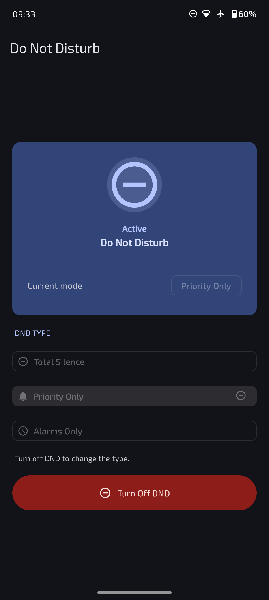
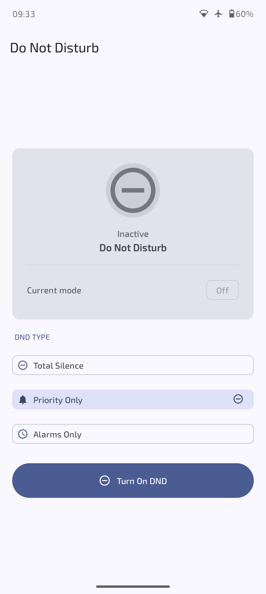

# DND
---

DND is a simple app to control Do Not Disturb. 
It shows if DND is on or off and which mode is active, 
then lets you turn it on or off and pick the mode (Total Silence, Priority Only, or Alarms Only).

The first time you open it, grant Notification Policy Access when asked. 
After that, use the main screen or the Quick Settings tile (tap to toggle, long-press to open the app). 
The app only changes DND and never touches your ringer mode.

---
## Screenshot

  
  &nbsp;
  

---
